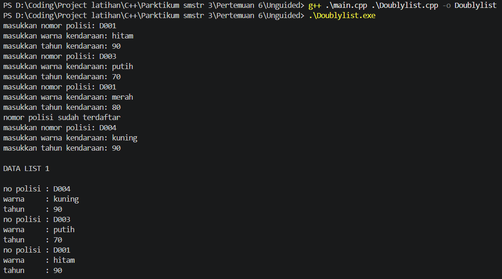
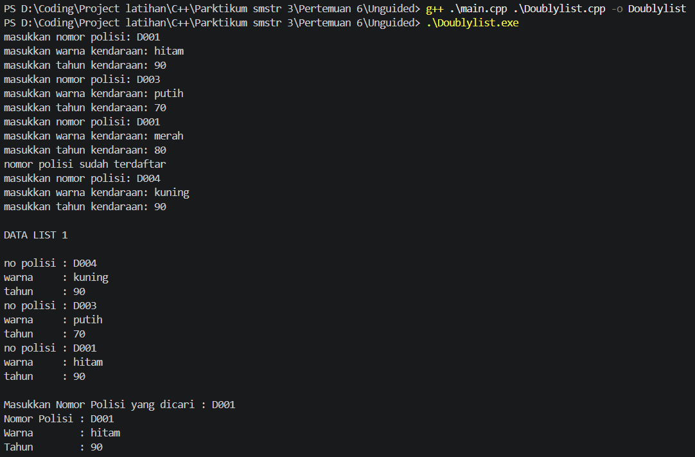
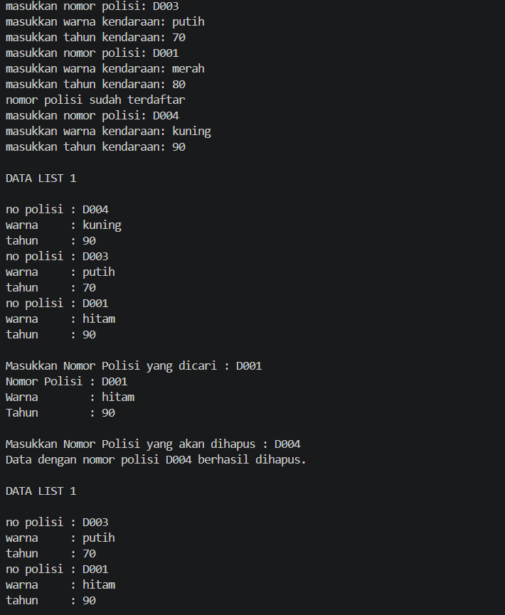

# <h1 align="center">Laporan Praktikum Modul 6 - DOUBLY LINKED LIST (BAGIAN PERTAMA)</h1>
<p align="center">I Kadek Indra Mahottama - 109082500039</p>

## Dasar Teori
*Doubly Linked List* adalah pengembangan dari struktur data senarai berantai di mana masing-masing elemennya (*node*) memiliki dua buah *successor* atau *pointer* penghubung [1]. Berbeda dengan varian tunggal (*singly*), setiap elemen pada *Doubly Linked List* dilengkapi dengan *pointer* penunjuk ke elemen sesudahnya (`next`) sekaligus *pointer* penunjuk kembali ke elemen sebelumnya (`prev`) [1]. Karakteristik ini memberikan keunggulan berupa kemampuan untuk melakukan penelusuran (iterasi) data secara dua arah: dari depan ke belakang (*maju*) maupun dari belakang ke depan (*mundur*) [1]. 

Dalam representasi utuhnya, *Doubly Linked List* dikendalikan oleh dua *pointer* utama, yakni `first` yang bertugas menunjuk elemen paling awal dalam list, dan `last` yang menunjuk secara spesifik ke elemen paling akhir [1]. Pada kasus sebuah list yang hanya memuat satu elemen (tunggal), *pointer* `next` dan `prev` dari elemen tersebut, beserta `first` dan `last` dari list, akan sama-sama mengarah pada simpul yang identik (atau `NULL` pada ujung-ujungnya) [1].

Meskipun secara arsitektur lebih kompleks dari *Singly Linked List*, pengoperasian *Abstract Data Type* (ADT) pada *Doubly Linked List* pada dasarnya mengusung logika primitif yang serupa: meliputi `insertFirst`, `insertLast`, `insertAfter`, `insertBefore`, `deleteFirst`, `deleteLast`, `deleteAfter`, dan `deleteBefore` [1]. Letak tantangannya hanyalah pada pemeliharaan rantai koneksi; di mana setiap kali operasi penyisipan atau penghapusan elemen dieksekusi, pemrogram harus memastikan pergeseran kedua buah *pointer* (`next` dan `prev`) dari seluruh *node* yang berdampingan diperbarui secara cermat agar integritas *linked list* tidak terputus [1].

## Guided 

### 1. Implementasi ADT Doubly Linked List

#### File `Doublylist.h`
```C++
#ifndef DOUBLYLIST_H
#define DOUBLYLIST_H
#include <string>
using namespace std;

struct barang {
    string kode;
    string nama;
    int tahun;
};

using infotype = barang;
struct elmlist;
using address = elmlist*;
struct elmlist {infotype info; address prev; address next;};
struct list {address first; address last;};

void CreateList(list &L);
address alokasi( const infotype &x);
void dealokasi(address &P);
void insertFirst(list &L, address P);
void insertLast(list &L, address P);
void insertAfter(list &L, address R, address P);
void insertBefore(list &L, address R, address P);
void printInfo(const list &L);
address findElm(const list &L, const string &kode);
void deleteFirst(list &L, address &P);
void deleteLast(list &L, address &P);
void deleteAfter(list &L, address prec, address &P);
void deleteBefore(list &L, address prec, address &P);
#endif
```

#### File `Doublylist.cpp`
```C++
#include <iostream>
#include <iomanip>
#include "Doublylist.h"
using namespace std;

void CreateList(list &L) { L.first = nullptr; L.last = nullptr; }

address alokasi(const infotype &x) {
    address P = new elmlist;
    P->info = x;
    P->prev = nullptr; P->next = nullptr;
    return P;
}
void dealokasi(address &P) {
    if (P != nullptr) { delete P; P = nullptr; }
}
void insertFirst(list &L, address P) {
    if (!P) return;
    P->prev = nullptr; P->next = L.first;
    if (L.first) L.first->prev = P;
    else L.last = P;
    L.first = P;
}
void insertLast(list &L, address P) {
    if (!P) return;
    P->next = nullptr; P->prev = L.last;
    if (L.last) L.last->next = P;
    else L.first = P;
    L.last = P;
}

void insertAfter(list &L, address R, address P) {
    if (!R || !P) return;
    P->prev = R;
    P->next = R->next;
    if (R->next) R->next->prev = P;
    else L.last = P;
    R->next = P;
}

void insertBefore(list &L, address R, address P) {
    if (!R || !P) return;
    P->next = R;
    P->prev = R->prev;
    if (R->prev) R->prev->next = P;
    else L.first = P;
    R->prev = P;
}
void printInfo(const list &L) {
    address P = L.first;
    if (!P) {
        cout << "List kosong.\n";
        return;
    }

    cout << "+--------+------------+-------+\n";
    cout << "| Kode   | Nama       | Tahun |\n";
    cout << "+--------+------------+-------+\n";
    while (P) {
        cout << "| " << left << setw(6) << P->info.kode
             << " | " << setw(10) << P->info.nama
             << " | " << setw(5) << P->info.tahun << " |\n";
        P = P->next;
    }
    cout << "+--------+------------+-------+\n";
}
address findElm(const list &L, const string &kode) {
    address P = L.first;
    while (P) {
        if (P->info.kode == kode) return P;
        P = P->next;
    }
    return nullptr;
}
void deleteFirst(list &L, address &P) {
    if (!L.first) { P = nullptr; return; }
    P = L.first; L.first = P->next;
    if (L.first) L.first->prev = nullptr;
    else L.last = nullptr;
    P->prev = P->next = nullptr;
}
void deleteLast(list &L, address &P) {
    if (!L.last) { P = nullptr; return; }
    P = L.last; L.last = P->prev;
    if (L.last) L.last->next = nullptr;
    else L.first = nullptr;
    P->prev = P->next = nullptr;
}

void deleteAfter(list &L, address prec, address &P) {
    P = nullptr;
    if (!prec || !prec->next) return;
    P = prec->next; prec->next = P->next;
    if (P->next) P->next->prev = prec;
    else L.last = prec;
    P->prev = P->next = nullptr;
}

void deleteBefore(list &L, address succ, address &P) {
    P = nullptr;
    if (!succ || !succ->prev) return;
    P = succ->prev; succ->prev = P->prev;
    if (P->prev) P->prev->next = succ;
    else L.first = succ;
    P->prev = P->next = nullptr;
}
```

#### File `main.cpp`
```C++
#include <iostream>
#include "Doublylist.h"
using namespace std;

void tampilkanJudul(const string &judul) {
    cout << "\n========================================\n";
    cout << judul << '\n';
    cout << "========================================\n";
}

int main() {
    list L;
    CreateList(L);

    infotype barang1 = {"B001", "Laptop", 2020};
    infotype barang2 = {"B002", "Monitor", 2022};
    infotype barang3 = {"B003", "Keyboard", 2023};
    infotype barang4 = {"B004", "Mouse", 2024};

    address P = nullptr;
    address posisi = nullptr;

    cout << "DEMONSTRASI OPERASI DOUBLY LINKED LIST\n";
    cout << "Data yang digunakan: B001, B002, B003, dan B004\n";

    tampilkanJudul("[1] INSERT FIRST");
    cout << "Menambahkan B002 di awal list.\n";
    insertFirst(L, alokasi(barang2));
    printInfo(L);

    tampilkanJudul("[2] INSERT LAST");
    cout << "Menambahkan B004 di akhir list.\n";
    insertLast(L, alokasi(barang4));
    printInfo(L);

    tampilkanJudul("[3] INSERT AFTER");
    cout << "Menambahkan B003 setelah B002.\n";
    posisi = findElm(L, "B002");
    if (posisi != nullptr) {
        insertAfter(L, posisi, alokasi(barang3));
    }
    printInfo(L);

    tampilkanJudul("[4] INSERT BEFORE");
    cout << "Menambahkan B001 sebelum B002.\n";
    posisi = findElm(L, "B002");
    if (posisi != nullptr) {
        insertBefore(L, posisi, alokasi(barang1));
    }
    printInfo(L);

    tampilkanJudul("[5] FIND ELEMENT");
    cout << "Mencari barang dengan kode B003.\n";
    posisi = findElm(L, "B003");
    if (posisi != nullptr) {
        cout << "Data ditemukan:\n";
        cout << "  Kode  : " << posisi->info.kode << '\n';
        cout << "  Nama  : " << posisi->info.nama << '\n';
        cout << "  Tahun : " << posisi->info.tahun << '\n';
    } else {
        cout << "Data tidak ditemukan.\n";
    }

    tampilkanJudul("[6] DELETE AFTER");
    cout << "Menghapus node setelah B002 (B003).\n";
    posisi = findElm(L, "B002");
    deleteAfter(L, posisi, P);
    if (P != nullptr) {
        cout << "Node yang dihapus: " << P->info.kode << '\n';
        dealokasi(P);
    } else {
        cout << "Tidak ada node yang dapat dihapus.\n";
    }
    printInfo(L);

    tampilkanJudul("[7] DELETE BEFORE");
    cout << "Menghapus node sebelum B004 (B002).\n";
    posisi = findElm(L, "B004");
    deleteBefore(L, posisi, P);
    if (P != nullptr) {
        cout << "Node yang dihapus: " << P->info.kode << '\n';
        dealokasi(P);
    } else {
        cout << "Tidak ada node yang dapat dihapus.\n";
    }
    printInfo(L);

    tampilkanJudul("[8] DELETE FIRST");
    cout << "Menghapus node pertama.\n";
    deleteFirst(L, P);
    if (P != nullptr) {
        cout << "Node yang dihapus: " << P->info.kode << '\n';
        dealokasi(P);
    } else {
        cout << "List kosong, tidak ada node yang dapat dihapus.\n";
    }
    printInfo(L);

    tampilkanJudul("[9] DELETE LAST");
    cout << "Menghapus node terakhir.\n";
    deleteLast(L, P);
    if (P != nullptr) {
        cout << "Node yang dihapus: " << P->info.kode << '\n';
        dealokasi(P);
    } else {
        cout << "List kosong, tidak ada node yang dapat dihapus.\n";
    }
    printInfo(L);

    tampilkanJudul("SELESAI");
    cout << "Kondisi list: "
         << (L.first == nullptr && L.last == nullptr ? "kosong.\n" : "masih berisi data.\n");

    return 0;
}
```
Penulisan kode pada bagian *guided* ini menunjukkan realisasi dari arsitektur *Doubly Linked List* berbasis *Abstract Data Type* (ADT). Modul ini menggunakan tipe data komposit (`struct barang`) yang mencakup kode, nama, dan tahun sebagai `info`. Keistimewaan *Doubly Linked List* terangkum jelas pada `elmlist` yang memuat dua *pointer* penunjuk (`prev` dan `next`) serta pada kerangka utama `list` yang mengusung *pointer* `first` dan `last`. Pada file *header*, 13 fungsi primitif dideklarasikan, disusul rincian implementasi manipulasi pergeseran rantai dua arah pada *file* `.cpp`. Pada pengujian di `main.cpp`, program secara gamblang mensimulasikan sembilan skenario modifikasi struktur data (mulai dari *insert first* hingga *delete last*) beserta pencetakan tabel *output* interaktif di setiap langkahnya.

## Unguided 

### 1. Buatlah ADT Doubly Linked List (Latihan 1, 2, 3) di dalam file "Doublylist.h", implementasi di "Doublylist.cpp", dan demonstrasikan pengujian fungsi penambahan data kendaraan, fungsi pencarian, dan prosedur penghapusan di "main.cpp".

#### File `Doublylist.h`
```C++
#ifndef DOUBLYLIST_H
#define DOUBLYLIST_H

#include <iostream>
#include <string>
using namespace std;

#define Nil NULL

struct kendaraan {
    string nopol; 
    string warna; 
    int thnBuat;      
};

typedef kendaraan infotype;
typedef struct ElmList *address;

struct ElmList {
    infotype info;  
    address next;   
    address prev;   
};

struct List {
    address First; 
    address Last;  
};

void CreateList(List &L);
address alokasi(infotype x);
void dealokasi(address &P);
void printInfo(List L);
void insertLast(List &L, address P);

// nomor 2
address findElm(List L, string nopol);

// nomor 3
void deleteFirst(List &L, address &P);
void deleteLast(List &L, address &P);
void deleteAfter(address Prec, address &P);
void deleteElm(List &L, string nopol, bool &status);

#endif
```

#### File `Doublylist.cpp`
```C++
#include "Doublylist.h"

void CreateList(List &L) {
    L.First = Nil;
    L.Last = Nil;
}

address alokasi(infotype x) {
    address P = new ElmList;
    if (P != Nil) {
        P->info = x;
        P->next = Nil;
        P->prev = Nil; 
    }
    return P;
}

void dealokasi(address &P) {
    delete P;
    P = Nil;
}

void printInfo(List L) {
    address P = L.Last;
    if (P == Nil) {
        cout << "List kosong." << endl;
        return;
    }
    while (P != Nil) {
        cout << "no polisi : " << P->info.nopol << endl;   
        cout << "warna     : " << P->info.warna << endl;   
        cout << "tahun     : " << P->info.thnBuat << endl; 
        P = P->prev;
    }
}

void insertLast(List &L, address P) {
    if (L.First == Nil) { 
        L.First = P;
        L.Last = P;
    } else {
        P->prev = L.Last;        
        (L.Last)->next = P;     
        L.Last = P;               
    }
}
// nomor 2
address findElm(List L, string nopol) {
    address P = L.First;
    while (P != Nil) {
        if (P->info.nopol == nopol) {
            return P;
        }
        P = P->next;
    }
    return Nil;
}
// nomor 3
void deleteFirst(List &L, address &P) {
    P = L.First; 
    if (L.First == L.Last) { 
        L.First = Nil;
        L.Last = Nil;
    } else {
        L.First = P->next;     
        (L.First)->prev = Nil; 
        P->next = Nil;         
    }
}

void deleteLast(List &L, address &P) {
    P = L.Last; 
    if (L.First == L.Last) { 
        L.First = Nil;
        L.Last = Nil;
    } else {
        L.Last = P->prev;      
        (L.Last)->next = Nil; 
        P->prev = Nil;         
    }
}

void deleteAfter(address Prec, address &P) {
    P = Prec->next;
    Prec->next = P->next;     
    if (P->next != Nil) {
        (P->next)->prev = Prec; 
    }
    P->next = Nil;            
    P->prev = Nil;           
}

void deleteElm(List &L, string nopol, bool &status) {
    address P = findElm(L, nopol);
    status = false;

    if (P != Nil) {
        if (P == L.First) {
            deleteFirst(L, P);
        } else if (P == L.Last) {
            deleteLast(L, P);
        } else {
            address Prec = P->prev;
            deleteAfter(Prec, P);
        }
        dealokasi(P); 
        status = true;
    }
}
```

#### File `main.cpp`
```C++
#include <iostream>
#include "Doublylist.h"

using namespace std;

void inputData(List &L) {
    infotype data;
    address P;

    cout << "masukkan nomor polisi: "; cin >> data.nopol;
    cout << "masukkan warna kendaraan: "; cin >> data.warna;
    cout << "masukkan tahun kendaraan: "; cin >> data.thnBuat;
    
    if (findElm(L, data.nopol) == Nil) {
        P = alokasi(data); 
        insertLast(L, P);  
    } else {
        cout << "nomor polisi sudah terdaftar" << endl; 
    }
}

int main() {
    List L;
    CreateList(L); 
    address P;

    inputData(L); 
    inputData(L); 
    inputData(L); 
    inputData(L); 

    cout << "\nDATA LIST 1\n" << endl; 
    printInfo(L); 
    // nomor 2
    string Caripol;
    cout << "\nMasukkan Nomor Polisi yang dicari : "; 
    cin >> Caripol; 
    
    P = findElm(L, Caripol); 
    if (P != Nil) {
        cout << "Nomor Polisi : " << P->info.nopol << endl; 
        cout << "Warna        : " << P->info.warna << endl; 
        cout << "Tahun        : " << P->info.thnBuat << endl; 
    } else {
        cout << "Data dengan nomor polisi " << Caripol << " tidak ditemukan." << endl;
    }
    // nomor 3
    string hapurNomor;
    bool hapusBerhasil;
    cout << "\nMasukkan Nomor Polisi yang akan dihapus : ";
    cin >> hapurNomor;

    deleteElm(L, hapurNomor, hapusBerhasil); 

    if (hapusBerhasil) {
        cout << "Data dengan nomor polisi " << hapurNomor << " berhasil dihapus." << endl; 
    } else {
        cout << "Data dengan nomor polisi " << hapurNomor << " tidak ditemukan." << endl;
    }
    
    cout << "\nDATA LIST 1\n" << endl; 
    printInfo(L); 

    return 0;
}
```

### Output Unguided 1, 2, 3 :

##### Output 1


##### Output 2


##### Output 3


Kode implementasi *unguided* ini merupakan penyelesaian serentak untuk kasus Latihan 1, 2, dan 3 yang mengelola data kendaraan (berisi plat nomor, warna, dan tahun produksi) ke dalam *Doubly Linked List*. Berbeda dengan penelusuran normal, fungsi primitif `printInfo` di sini ditelusuri dari titik belakang list (`P = L.Last`) lalu berjalan mundur (`P = P->prev`) hingga ke pangkal, sehingga data yang ditampilkan akan disusun dengan format LIFO (*Last In First Out*).

Pada simulasi *input*, prosedur `inputData` memastikan agar tidak ada plat nomor ganda (duplikat) yang disisipkan ke dalam *list* dengan cara memanfaatkan pemanggilan fungsi `findElm` sebagai validasi awal sebelum mengeksekusi penyisipan `insertLast`. Fitur Latihan 3 tercermin pada operasi komprehensif `deleteElm`, di mana program mendelegasikan tugas pemutusan rantai (*unlink*) *pointer* `next` dan `prev` ke dalam tiga cabang seleksi: `deleteFirst` apabila node target berada paling depan, `deleteLast` bila paling belakang, dan `deleteAfter` (yang menggunakan *precursor pointer*) bila node terjepit di tengah untaian *list*.

## Kesimpulan
Melalui penyelesaian Modul 6 ini, dapat disimpulkan bahwa *Doubly Linked List* hadir sebagai penyempurnaan struktural dari varian *singly* berkat hadirnya *pointer* pendamping ganda (`next` dan `prev`). Kapabilitas penelusuran dua arah (maju dan mundur) sangat memudahkan pengolahan data adaptif, seperti membalik urutan cetak (*reverse traversal*) pada fungsi `printInfo` yang bermula dari pointer `Last` dan terus merunut rute `prev`. Pendekatan ADT turut menuntut kehati-hatian tingkat tinggi pada saat merealisasikan fungsi penggeseran posisi data. Operasi sisipan (`insert`) maupun modifikasi rantai (`delete`) mengharuskan pemrogram tidak hanya menjalin satu hubungan sambungan, melainkan sepasang tautan memori di antara *node* depan dan belakang sekaligus demi mempertahankan konsistensi struktur keseluruhan.

## Referensi
[1] Modul Praktikum, "Modul 6: DOUBLY LINKED LIST (BAGIAN PERTAMA)," Modul 06 STUKDAT.pdf, 2024.
<br>[2] Triase. (2020). *Diktat Edisi Revisi : STRUKTUR DATA*. Medan: UNIVERSITAS ISLAM NEGERI SUMATERA UTARA MEDAN. 
<br>[3] Indahyati, Uce., Rahmawati Yunianita. (2020). *BUKU AJAR ALGORITMA DAN PEMROGRAMAN DALAM BAHASA C++*. Sidoarjo: Umsida Press. Diakses melalui https://doi.org/10.21070/2020/978-623-6833-67-4.