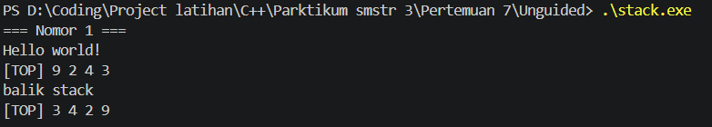
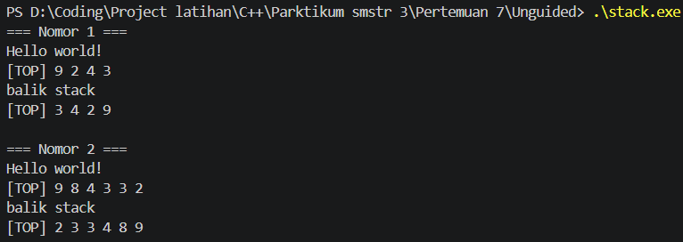
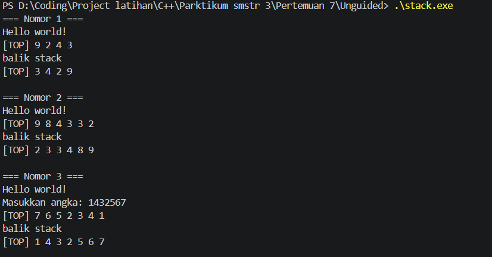

# <h1 align="center">Laporan Praktikum Modul 7 - STACK</h1>
<p align="center">I Kadek Indra Mahottama - 109082500039</p>

## Dasar Teori
*Stack* (Tumpukan) merupakan salah satu bentuk struktur data linear yang menerapkan prinsip operasi LIFO (*Last In First Out*) [1]. Sesuai dengan namanya, data dianalogikan seperti sebuah tumpukan barang, elemen yang terakhir kali dimasukkan (*insert*) ke dalam *stack* akan menjadi elemen pertama yang diambil atau dikeluarkan (*delete*) [1]. 

Komponen utama yang mengendalikan struktur data ini adalah indeks atau *pointer* penunjuk yang disebut `Top`. Akses manipulasi data pada *stack* bersifat sangat terbatas karena program hanya diizinkan untuk membaca, menambah, maupun menghapus elemen pada posisi `Top` saja [1]. Berdasarkan representasinya, struktur *stack* dapat diimplementasikan menggunakan dua cara, yakni representasi *Pointer* (menggunakan *Linked List*) dan representasi Tabel (menggunakan *Array*) [1]. Pada representasi tabel, *stack* membutuhkan deklarasi kapasitas memori maksimum (misalnya `Imax`) sejak awal program, di mana nilai `Top` berperan sebagai integer indeks dari *array* tersebut [1]. 

Operasi dasar atau primitif pada sebuah *stack* jauh lebih sedikit dibandingkan senarai berantai biasa karena modifikasi data hanya terjadi di satu ujung [1]. Dua operasi paling esensial dalam *stack* adalah:
1. **Push:** Operasi untuk menyisipkan elemen baru ke bagian paling atas tumpukan. Pada representasi tabel, operasi ini dilakukan dengan menggeser (menambahkan) nilai indeks `Top` terlebih dahulu, lalu memasukkan nilai baru ke indeks tersebut (`Top = Top + 1`) [1].
2. **Pop:** Operasi untuk mengambil atau mengeluarkan elemen dari posisi teratas tumpukan. Setelah elemen dari indeks `Top` dipindahkan atau dikembalikan nilainya, indeks `Top` akan diturunkan satu langkah ke bawah (`Top = Top - 1`) [1].

## Guided 

### 1. Implementasi ADT Stack menggunakan Representasi Tabel (Array)

#### File `stack.h`
```C++
#ifndef STACK_H_INCLUDED
#define STACK_H_INCLUDED
#include <iostream>

using namespace std;

struct infotype {
    char nim[20];
    char nama[20];
};

struct Stack {
    infotype info[10];
    int Top;
};

int isEmpty(Stack S);

void createStack(Stack &S);

void push(Stack &S, infotype X);

void pop(Stack &S, infotype &X);

void viewStack(Stack S);

#endif // STACK_H_INCLUDED
```

#### File `stack.cpp`
```C++
#include "stack.h"

int isEmpty(Stack S) {
    if (S.Top == 0) {
        return 0;
    } else {
        return 1;
    }
}

void createStack(Stack &S) {
    S.Top = 0;
}

void push(Stack &S, infotype X) {
    if (S.Top < 10) {
        S.Top=S.Top + 1;
        S.info[S.Top - 1]= X;
    } else {
        cout<<"Stack, penuh data tidak bisa ditambahkan" << endl;
    }
}

void pop(Stack &S, infotype &X) {
    if (isEmpty(S) != 0) {
        X = S.info[S.Top-1];
        S.Top = S.Top -1;
    } else {
        cout<<"Stack kosong, tidak ada data yang bisa diambil"<<endl;
    }
}

void viewStack(Stack S) {
    if (isEmpty(S)==0) {
        cout<<"Stack kosong"<<endl;
    } else {
        cout<<"Isi Stack (dari TOP): "<<endl;
        for (int i= S.Top; i>=1;i--) {
            cout<<i<<". "<<S.info[i-1].nim<<"-"<<S.info[i-1].nama<<endl;
        }
    }
}
```

#### File `main.cpp`
```C++
#include <iostream>
#include <cstring>
#include "stack.h"
using namespace std;

int main(){
    Stack S;
    infotype data,hasil;

    createStack(S);
    cout<<"Stack baru dibuar, Top = "<< S.Top<<endl;
    viewStack(S);

    cout<<endl<<"--- Push 3 data ---" << endl;
    strcpy(data.nim, "103112400001");
    strcpy(data.nama, "Andi");
    push(S,data);

    strcpy(data.nim, "10311240002");
    strcpy(data.nama, "Budi");
    push(S,data);

    strcpy(data.nim, "10311240004");
    strcpy(data.nama, "Citra");
    push(S,data);
    viewStack(S);

    cout<<endl<<"--- Pop 1 data ---"<<endl;
    pop(S,hasil);
    cout<<"Data yang diambil: "<< hasil.nim<<" - "<<hasil.nama<<endl;
    viewStack(S);

    cout<<endl<<"--- Pop sampai kosong ---"<<endl;
    pop(S,hasil);
    pop(S,hasil);
    pop(S,hasil);
    viewStack(S);

    return 0;
}
```
Penulisan untuk *guided* ini menerapkan *Stack* menggunakan representasi Array berbasis ADT. Program memuat tipe data bentukan (`struct infotype`) berisi array karakter `nim` dan `nama`. Kapasitas *stack* dibatasi maksimum 10 elemen, di mana inisialisasi tumpukan kosong ditandai dengan penetapan `Top = 0`. Pada saat memanggil prosedur `push`, indeks `Top` dinaikkan ke atas untuk menampung input mahasiswa baru. Sebaliknya, saat prosedur `pop` dieksekusi, nilai `Top` dikurangi yang secara logis langsung mendepak data teratas keluar dari penelusuran. Simulasi pada `main.cpp` mengeksekusi operasi secara berurutan mulai dari pemasukan tiga data, pemanggilan satu per satu (*Pop*), hingga *stack* bersih seluruhnya.

## Unguided 

### 1. Buatlah ADT Stack menggunakan ARRAY di dalam file "stack.h", implementasi di "stack.cpp", dan panggil Latihan 1, 2, 3 secara sekuensial di "main.cpp".

#### File `stack.h`
```C++
#ifndef STACK_H_INCLUDED
#define STACK_H_INCLUDED
#include <iostream>

using namespace std;

typedef int infotype;

struct Stack {
    infotype info[20];
    int top;
};

void createStack(Stack &S);
void Push(Stack &S, infotype x);
infotype pop(Stack &S);
void printInfo(Stack S);
void balikStack(Stack &S);

// Soal 2
void pushAscending(Stack &S, infotype x);

// Soal 3
void getInputStream(Stack &S);

#endif // STACK_H_INCLUDED
```

#### File `stack.cpp`
```C++
#include "stack.h"

void createStack(Stack &S) {
    S.top = -1;
}

void Push(Stack &S, infotype x) {
    if (S.top < 19) {
        S.top++;
        S.info[S.top] = x;
    } else {
        cout << "Stack penuh!" << endl;
    }
}

infotype pop(Stack &S) {
    if (S.top >= 0) {
        infotype temp = S.info[S.top];
        S.top--;
        return temp;
    } else {
        return -1;
    }
}

void printInfo(Stack S) {
    if (S.top >= 0) {
        cout << "[TOP] ";
        for (int i = S.top; i >= 0; i--) {
            cout << S.info[i] << " ";
        }
        cout << endl;
    } else {
        cout << "Stack Kosong" << endl;
    }
}

void balikStack(Stack &S) {
    Stack temp1, temp2;
    createStack(temp1);
    createStack(temp2);
    while (S.top != -1) {
        Push(temp1, pop(S));
    }
    while (temp1.top != -1) {
        Push(temp2, pop(temp1));
    }
    while (temp2.top != -1) {
        Push(S, pop(temp2));
    }
}

//Nomor 2
void pushAscending(Stack &S, infotype x) {
    Stack temp;
    createStack(temp);

    while (S.top != -1 && S.info[S.top] > x) {
        Push(temp, pop(S));
    }
    Push(S, x);
    while (temp.top != -1) {
        Push(S, pop(temp));
    }
}

//Nomor 3
void getInputStream(Stack &S) {
    char input;
    cout << "Masukkan angka: ";
    while (cin.get(input) && input != '\n') {
        if (input >= '0' && input <= '9') {
            int n = input - '0';
            Push(S, n);
        }
    }
}
```

#### File `main.cpp`
```C++
#include <iostream>
#include "stack.h"

using namespace std;

int main() {
    Stack S;

    cout << "=== Nomor 1 ===" << endl;
    cout << "Hello world!" << endl;
    
    createStack(S);
    Push(S, 3);
    Push(S, 4);
    Push(S, 8);
    pop(S);
    Push(S, 2);
    Push(S, 3);
    pop(S);
    Push(S, 9);
    
    printInfo(S);
    cout << "balik stack" << endl;
    balikStack(S);
    printInfo(S);
    cout << endl;

    cout << "=== Nomor 2 ===" << endl;
    cout << "Hello world!" << endl;
    
    createStack(S);
    pushAscending(S, 3);
    pushAscending(S, 4);
    pushAscending(S, 8);
    pushAscending(S, 2);
    pushAscending(S, 3);
    pushAscending(S, 9);
    
    printInfo(S);
    cout << "balik stack" << endl;
    balikStack(S);
    printInfo(S);
    cout << endl;

    cout << "=== Nomor 3 ===" << endl;
    cout << "Hello world!" << endl;
    
    createStack(S);
    getInputStream(S);
    
    printInfo(S);
    cout << "balik stack" << endl;
    balikStack(S);
    printInfo(S);
    cout << endl;

    return 0;
}
```

### Output Unguided 1 :

##### Output Nomor 1


##### Output Nomor 2


##### Output Nomor 3


Kode program yang saya buat ini menerapkan tiga fungsi manipulasi *stack* array secara berurutan. Pada prosedur `balikStack`, pembalikan elemen diproses menggunakan bantuan dua buah *stack* sementara (*temporary*), di mana elemen-elemen dari *stack* asli digeser (di-*pop* lalu di-*push*) secara beranting ke memori sementara agar saat dimasukkan kembali urutannya terbalik secara sempurna. Pada fungsi `pushAscending`, *stack* dipertahankan dalam kondisi selalu berurutan (nilai lebih kecil di bawah, besar di atas) dengan cara men*pop* sementara semua elemen yang bernilai lebih besar dari data baru `x` ke dalam *stack* cadangan, memasukkan `x` ke tempatnya, lalu memulangkan elemen-elemen besar tadi. Terakhir, pada fungsi dinamis `getInputStream`, program membaca aliran *input* murni per karakter menggunakan `cin.get()` hingga bertemu lambang 'Enter' (`\n`), menyaring karakter yang berupa digit numerik ('0'-'9'), mengkonversinya ke integer murni (`input - '0'`), dan kemudian mendorongnya langsung ke *stack* S. Pendekatan pada *main* tidak memakai *switch-case*, namun cukup mereset fungsi `createStack` secara berulang agar indikator *Top* bergeser ke `-1` untuk mengosongkan tempat bagi latihan berikutnya.

## Kesimpulan
Praktikum Modul 7 ini mendemonstrasikan kerangka konseptual serta realisasi teknis struktur data *Stack* menggunakan representasi *Array* dengan prinsip LIFO (*Last In First Out*). Terlihat jelas bahwa meskipun tidak sefleksibel pendekatan *pointer* dalam hal kapasitas dinamis, representasi tabel *array* memberikan efisiensi luar biasa pada implementasi pengkodean karena pengelolaannya tidak memerlukan operasi alokasi atau dealokasi memori yang rumit, kita cukup memanipulasi posisi satu variabel indikator, yakni `Top`. Pengerjaan *unguided* secara komprehensif membuktikan fungsi fundamental `Push` dan `Pop` tidak hanya berfungsi untuk sekadar memasukkan dan mengeluarkan nilai, namun bila dipadukan ke dalam algoritma bantuan (*temporary stack*), keduanya mampu membentuk fitur kompleks seperti pengurutan langsung (*pushAscending*) maupun pembalikan barisan memori data (*balikStack*).

## Referensi
[1] Modul Praktikum, "Modul 7: STACK," Modul 07 STACK.pdf, 2024.
<br>[2] Triase. (2020). *Diktat Edisi Revisi : STRUKTUR DATA*. Medan: UNIVERSITAS ISLAM NEGERI SUMATERA UTARA MEDAN. 
<br>[3] Indahyati, Uce., Rahmawati Yunianita. (2020). *BUKU AJAR ALGORITMA DAN PEMROGRAMAN DALAM BAHASA C++*. Sidoarjo: Umsida Press. Diakses melalui https://doi.org/10.21070/2020/978-623-6833-67-4.