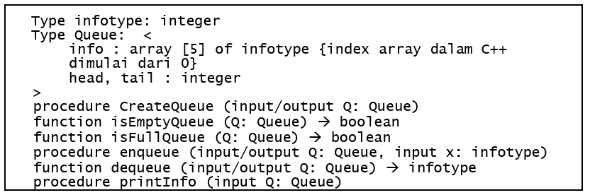
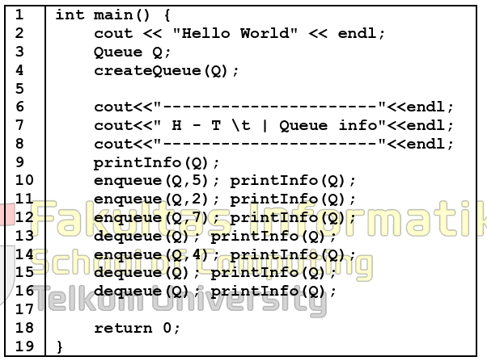
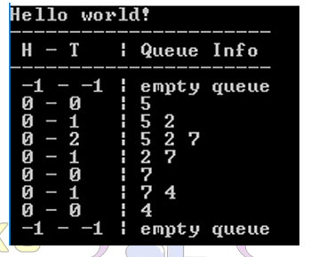
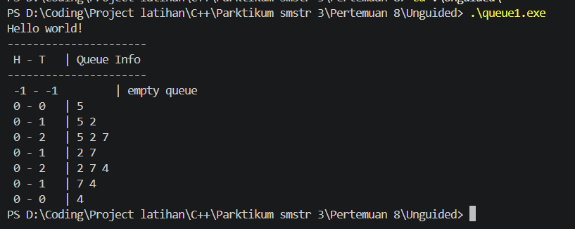
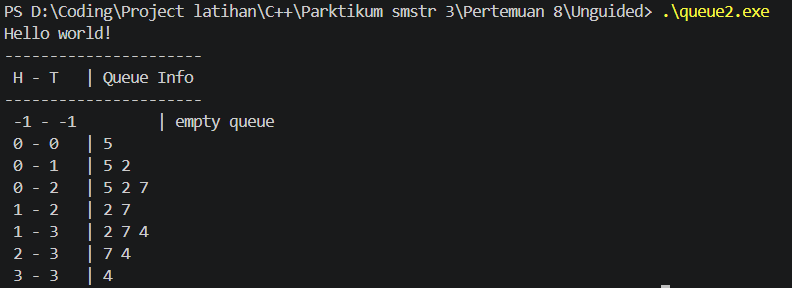
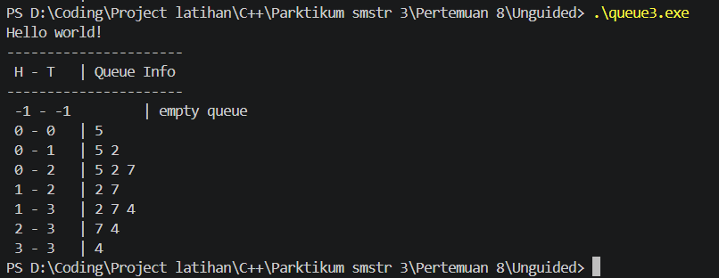

# <h1 align="center">Laporan Praktikum Modul 8 - QUEUE</h1>
<p align="center">I Kadek Indra Mahottama - 109082500039</p>

## Dasar Teori
*Queue* (antrean) merupakan struktur data linear yang bekerja dengan prinsip **FIFO (*First In First Out*)**, di mana elemen yang pertama kali masuk ke dalam antrean akan menjadi elemen pertama yang diakses atau dikeluarkan [1, 2]. Cara kerja struktur ini dapat dianalogikan seperti antrean pada loket pembelian tiket kereta api [1]. Berbeda dengan *stack* yang hanya memiliki satu ujung akses (`Top`), *queue* dikendalikan oleh dua penunjuk utama, yakni `head` (ujung depan antrean tempat penghapusan data dilakukan) dan `tail` (ujung belakang antrean tempat penyisipan data dilakukan) [1]. Dua operasi paling fundamental pada *queue* adalah **Enqueue** (menambahkan elemen baru pada bagian `tail`) dan **Dequeue** (mengambil atau menghapus elemen pada bagian `head`) [1, 2].

Dalam bahasa C++, *Abstract Data Type* (ADT) *queue* dapat diimplementasikan menggunakan dua jenis representasi, yaitu representasi **Pointer (*Linked List*)** dan representasi **Tabel (*Array*)** [1, 3]. Pada representasi *pointer*, jumlah kapasitas antrean bersifat dinamis (tidak terbatas secara statis), namun membutuhkan manajemen memori manual berupa proses `alokasi` dan `dealokasi` untuk setiap simpulnya [1]. Sebaliknya, pada representasi tabel (*array*), kapasitas antrean bersifat terbatas sesuai ukuran *array* yang dideklarasikan sejak awal, tetapi tidak memerlukan proses manajemen memori dinamis [1].

Khusus untuk implementasi *queue* dengan representasi tabel (*array*), terdapat tiga mekanisme pengelolaan pergerakan indeks `head` dan `tail` [1]:
1. **Alternatif 1 (*Head* diam, *Tail* bergerak):** Indeks `head` selalu berada di posisi awal selama *queue* tidak kosong. Setiap kali operasi `dequeue` dijalankan, seluruh elemen di belakangnya harus digeser maju satu langkah dan indeks `tail` dikurangi satu. Cara ini sederhana tetapi kurang efisien karena selalu terjadi pergeseran data saat penghapusan [1].
2. **Alternatif 2 (*Head* bergerak, *Tail* bergerak):** Operasi `dequeue` cukup memajukan indeks `head` tanpa menggeser elemen. Mekanisme ini lebih efisien, namun dapat memunculkan kondisi *penuh semu* (indeks `tail` telah mencapai batas maksimum *array*, padahal masih ada ruang kosong di depan `head`), sehingga pergeseran seluruh elemen ke awal tetap perlu dilakukan saat kondisi tersebut terjadi [1].
3. **Alternatif 3 (*Head* dan *Tail* berputar / *Circular Buffer*):** Indeks `head` dan `tail` bergerak secara melingkar mengelilingi indeks *array* (menggunakan operasi modulo). Setelah mencapai indeks maksimum, posisi selanjutnya otomatis kembali ke indeks awal sehingga tidak diperlukan pergeseran elemen sama sekali [1].

## Guided 

### 1. Implementasi ADT Queue menggunakan Representasi Pointer (Linked List)

#### File `queue.h`
```C++
#ifndef QUEUE_H_INCLUDE
#define QUEUE_H_INCLUDE

#include <iostream>
using namespace std;

#define Nil NULL

typedef bool boolean;
typedef int infotype;
typedef struct elmQ *address;

struct elmQ{
   infotype info;
   address next;
};

struct queue {
   address head, tail;
};

boolean isEmpty(queue Q);
void CreateQueue(queue &Q);
address alokasi(infotype X);
void dealokasi(address P);
address findElm(queue Q, infotype X);
boolean fFindElm(queue Q, address P);
void insert(queue &Q, address P);
void deleteQueue(queue &Q, address &P);
void printInfo(queue Q);
int nbList(queue Q);
void delAll(queue &Q);

#endif
```

#### File `queue.cpp`
```C++
#include "queue.h"

boolean isEmpty(queue Q) {
    return (Q.head == Nil);
}

void CreateQueue(queue &Q) {
    Q.head = Nil;
    Q.tail = Nil;
}

address alokasi(infotype X) {
    address P = new (nothrow) elmQ;
    if (P != Nil) {
        P->info = X;
        P->next = Nil;
    }
    return P;
}

void dealokasi(address P) {
    delete P;
}

address findElm(queue Q, infotype X) {
    address P = Q.head;
    while (P != Nil) {
        if (P->info == X) {
            return P;
        }
        P = P->next;
    }
    return Nil;
}

boolean fFindElm(queue Q, address P) {
    address R = Q.head;
    while (R != Nil) {
        if (R == P) {
            return true;
        }
        R = R->next;
    }
    return false;
}

void insert(queue &Q, address P) { //enqueue
    if (isEmpty(Q)) {
        Q.head = P;
        Q.tail = P;
    } else {
        (Q.tail)->next = P;
        Q.tail = P;
    }
}

void deleteQueue(queue &Q, address &P) { //dequeue
    P = Q.head;
    if (Q.head == Q.tail) {
        Q.head = Nil;
        Q.tail = Nil;
    } else {
        Q.head = P->next;
    }
    P->next = Nil;
}

void printInfo(queue Q) {
    if (isEmpty(Q)) {
        cout << "Queue kosong" << endl;
    } else {
        address P = Q.head;
        while (P != Nil) {
            cout << P->info << " ";
            P = P->next;
        }
        cout << endl;
    }
}

int nbList(queue Q) {
    int jumlah = 0;
    address P = Q.head;
    while (P != Nil) {
        jumlah++;
        P = P->next;
    }
    return jumlah;
}

void delAll(queue &Q) {
    address P;
    while (!isEmpty(Q)) {
        deleteQueue(Q, P);
        dealokasi(P);
    }
}
```

#### File `main.cpp`
```C++
#include <iostream>
#include "queue.h"
using namespace std;

int main() {
    queue Q;
    address P; 

    CreateQueue(Q);
    cout << "isEmpty : " << isEmpty(Q) << endl;
    printInfo(Q);

    insert(Q, alokasi(5));
    insert(Q, alokasi(2));
    insert(Q, alokasi(7));
    cout << "Setelah insert 5, 2, 7" << endl;
    printInfo(Q);
    cout << "nbList  : " << nbList(Q) << endl;

    P = findElm(Q, 2);
    if (P != Nil) {
        cout << "findElm(2) ketemu, info = " << P->info << endl;
        cout << "fFindElm : " << fFindElm(Q, P) << endl;
    }
    if (findElm(Q, 9) == Nil) {
        cout << "findElm(9) tidak ketemu" << endl;
    }

    deleteQueue(Q, P);
    cout << "Setelah delete, elemen yang keluar = " << P->info << endl;
    dealokasi(P);
    printInfo(Q);

    delAll(Q);
    cout << "Setelah delAll" << endl;
    printInfo(Q);
    cout << "isEmpty : " << isEmpty(Q) << endl;

    return 0;
}
```
Program *guided* pertama ini mengimplementasikan ADT *Queue* menggunakan representasi *pointer* (*Singly Linked List*). Setiap elemen (`elmQ`) menyimpan data integer (`info`) dan *pointer* `next`, sedangkan struktur `queue` menyimpan dua *pointer* kendali yaitu `head` dan `tail`. Penambahan elemen dilakukan melalui prosedur `insert` (*enqueue*) pada ujung `tail`, sementara penghapusan dilakukan melalui prosedur `deleteQueue` (*dequeue*) pada ujung `head` disertai manajemen memori dinamis `alokasi` dan `dealokasi`. Selain operasi dasar antrean, program ini juga dilengkapi fitur pencarian berdasarkan nilai (`findElm`), pencarian berdasarkan alamat (`fFindElm`), penghitungan jumlah elemen (`nbList`), serta pengosongan total antrean (`delAll`).

### 2. Implementasi ADT Queue menggunakan Representasi Tabel (Array)

#### File `queue-array.h`
```C++
#ifndef QUEUE_H
#define QUEUE_H

#include <iostream>
using namespace std;

const int MAKSIMAL = 5;

struct queue {
    string nama[MAKSIMAL];
    int head;
    int tail;
};

bool isFull(queue Q);
bool isEmpty(queue Q);
void CreateQueue(queue &Q);
void enQueue(queue &Q, string nama);
void deQueue(queue &Q);
void viewQueue(queue Q);

#endif
```

#### File `queue-array.cpp`
```C++
#include "queue-array.h"
#include <iostream>

using namespace std;

// NOTE : 
// Implementasi 1 = head diam, tail bergerak (Queue Linear Statis, kerana head nya tetap diam)
// Implementasi 2 = head bergerak, tail bergerak (Queue Linear Dinamis, karena head & tail nya sama-sama bergerak)
// Implementasi 3 = head dan tail berputar (Queue Circular, karena jika udh mentok tapi masih ada space, diputar sehingga tail bisa ada didepan head)

bool isEmpty(queue Q){
    if(Q.head == -1 && Q.tail == -1){
        return true;
    } else {
        return false;
    }
}

//isFull implmenetasi 1
bool isFull(queue Q){
    if(Q.tail == MAKSIMAL - 1){
        return true;
    } else {
        return false;
    }
}

// //isFull implementasi 2
// bool isFull(queue Q){
//     if(Q.head == 0 && Q.tail == MAKSIMAL - 1){
//         return true;
//     } else {
//         return false;
//     }
// }

// //isFull implementasi 3
// bool isFull(queue Q){
//     if((Q.tail + 1) % MAKSIMAL == Q.head){
//         return true;
//     } else {
//         return false;
//     }
// }

void CreateQueue(queue &Q){ //terbentuk queue dengan head = -1 dan tail = -1 
    Q.head = -1;
    Q.tail = -1;
}
 

//enqueue implementasi 1
void enQueue(queue &Q, string nama){
    if(isFull(Q) == true){
        cout << "Queue sudah penuh!" << endl;
    } else {
        if(isEmpty(Q) == true){
            Q.head = Q.tail = 0;
        } else {
            Q.tail++;
        }
        Q.nama[Q.tail] = nama;
        cout << "nama " << nama << " berhasil ditambahkan kedalam queue!" << endl;
    }
}

// //enQueue implementasi 2
// void enQueue(queue &Q, string nama){
//     if(isFull(Q) == true){
//         cout << "Queue sudah penuh!" << endl;
//     } else {
//         if(isEmpty(Q) == true){
//             Q.head = Q.tail = 0;
//         } else {
//             if(Q.tail == MAKSIMAL - 1){ // penuh semu, geser elemen ke kiri
//                 int selisih = Q.head;
//                 for(int i = Q.head; i <= Q.tail; i++){
//                     Q.nama[i - selisih] = Q.nama[i];
//                 }
//                 Q.tail = Q.tail - selisih;
//                 Q.head = 0;
//             }
//             Q.tail++;
//         }
//         Q.nama[Q.tail] = nama;
//         cout << "nama " << nama << " berhasil ditambahkan kedalam queue!" << endl;
//     }
// }

// //enQueue implementasi 3
// void enQueue(queue &Q, string nama){
//     if(isFull(Q) == true){
//         cout << "Queue sudah penuh!" << endl;
//     } else {
//         if(isEmpty(Q) == true){
//             Q.head = Q.tail = 0;
//         } else {
//             Q.tail = (Q.tail + 1) % MAKSIMAL; // bergerak melingkar
//         }
//         Q.nama[Q.tail] = nama;
//         cout << "nama " << nama << " berhasil ditambahkan kedalam queue!" << endl;
//     }
// }

//dequeue implementasi 1
void deQueue(queue &Q){
    if(isEmpty(Q) == true){
        cout << "Queue kosong!" << endl;
    } else {
        cout << "Mengahapus data " << Q.nama[Q.head] << "..." << endl;
        for(int i = 0; i < Q.tail; i++){
            Q.nama[i] =  Q.nama[i+1];
        }
        Q.tail--;
        if(Q.tail < 0){ //kalo semua isi queue nya udh dikeluarin, set head & tail ke -1
            Q.head = -1;
            Q.tail = -1;
        }
    }
}

// //dequeue implementasi 2
// void deQueue(queue &Q){
//     if(isEmpty(Q) == true){
//         cout << "Queue kosong!" << endl;
//     } else {
//         cout << "Mengahapus data " << Q.nama[Q.head] << "..." << endl;
//         Q.head++;
//         if(Q.head > Q.tail){ //kalo elemennya udh abis (head akan lebih 1 dari tail), maka reset ulang head & tail ke -1
//             Q.head = -1;
//             Q.tail = -1;
//         }
//     }
// }

// //deQueue implementasi 3
// void deQueue(queue &Q){
//     if(isEmpty(Q) == true){
//         cout << "Queue kosong!" << endl;
//     } else {
//         cout << "Mengahapus data " << Q.nama[Q.head] << "..." << endl;
//         if(Q.head == Q.tail){ //kalo elemennya tinggal 1, langsungkan saja head & tail nya reset ke -1
//             Q.head = -1;
//             Q.tail = -1;
//         } else {
//             Q.head = (Q.head + 1) % MAKSIMAL; // bergerak melingkar
//         }
//     }
// }

//viewQueue implementasi 1 & 2
void viewQueue(queue Q){
    if(isEmpty(Q) == true){
        cout << "Queue kosong!" << endl;
    } else {
        for(int i = Q.head; i <= Q.tail; i++){
            cout << i -  Q.head + 1 << ". " << Q.nama[i] << endl;
        }
    }
    cout << endl;
}

// //viewQueue implementasi 3
// void viewQueue(queue Q){
//     if(isEmpty(Q) == true){
//         cout << "Queue kosong!" << endl;
//     } else {
//         int i = Q.head;
//         int count = 1;
//         while(true){
//             cout << count << ". " << Q.nama[i] << endl;
//             if(i == Q.tail){
//                 break;
//             }
//             i = (i + 1) % MAKSIMAL;
//             count++;
//         }   
//     }
// }
```

#### File `main.cpp`
```C++
#include "queue-array.h"
#include <iostream>

using namespace std;

int main(){
    queue Q;

    CreateQueue(Q);
    enQueue(Q, "Dimas");
    enQueue(Q, "Arvin");
    enQueue(Q, "Rizal");
    enQueue(Q, "Hafizh");
    enQueue(Q, "Fathur");
    enQueue(Q, "Daffa");
    cout << endl;

    cout << "--- Isi Queue Setelah enQueue ---" << endl;
    viewQueue(Q);
    cout << endl;

    deQueue(Q);
    deQueue(Q);
    deQueue(Q);
    deQueue(Q);
    // deQueue(Q);
    // deQueue(Q);
    cout << endl;

    cout << "--- Isi Queue Setelah deQueue ---" << endl;
    viewQueue(Q);

    return 0;
}
```
Program *guided* kedua ini mendemonstrasikan penerapan ADT *Queue* menggunakan representasi tabel (*array* bertipe `string`) dengan kapasitas maksimum `MAKSIMAL = 5`. Kondisi antrean kosong ditandai dengan `head = -1` dan `tail = -1`. Pada file `queue-array.cpp`, kode yang aktif menjalankan mekanisme Implementasi 1 (*head* diam, *tail* bergerak), sementara mekanisme Implementasi 2 (pergeseran saat penuh semu) dan Implementasi 3 (*circular queue* menggunakan modulo) juga dicantumkan dalam bentuk komentar sebagai referensi perbandingan. Pada `main.cpp`, program menguji pengisian 6 nama sehingga data ke-6 ditolak karena kapasitas antrean sudah penuh, kemudian dilakukan 4 kali penghapusan (`deQueue`) dari ujung depan dan mencetak sisa antrean.

## Unguided 

### 1. Buatlah ADT Queue menggunakan ARRAY di dalam file "queue.h", implementasikan pada file "queueAlt1.cpp" dengan menerapkan mekanisme queue Alternatif 1 (head diam, tail bergerak), serta uji pada file "main.cpp".

##### Gambar Soal 1_1


##### Gambar Soal 1_2


##### Gambar Soal 1_3


#### File `queue.h`
```C++
#ifndef QUEUE_H_INCLUDED
#define QUEUE_H_INCLUDED
#include <iostream>

using namespace std;

const int MAX = 5;
typedef int infotype;

struct Queue {
    infotype info[MAX];
    int head;
    int tail;
};

void createQueue(Queue &Q);
bool isEmptyQueue(Queue Q);
bool isFullQueue(Queue Q);
void enqueue(Queue &Q, infotype x);
infotype dequeue(Queue &Q);
void printInfo(Queue Q);

#endif // QUEUE_H_INCLUDED
```

#### File `queueAlt1.cpp`
```C++
#include "queue.h"

void createQueue(Queue &Q) {
    Q.head = -1;
    Q.tail = -1;
}

bool isEmptyQueue(Queue Q) {
    return (Q.head == -1 && Q.tail == -1);
}

bool isFullQueue(Queue Q) {
    return (Q.tail == MAX - 1);
}

void enqueue(Queue &Q, infotype x) {
    if (isFullQueue(Q)) {
        cout << "Queue penuh!" << endl;
    } else {
        if (isEmptyQueue(Q)) {
            Q.head = 0;
            Q.tail = 0;
            Q.info[0] = x;
        } else {
            Q.tail++;
            Q.info[Q.tail] = x;
        }
    }
}

infotype dequeue(Queue &Q) {
    if (isEmptyQueue(Q)) {
        cout << "Queue kosong!" << endl;
        return -1;
    } else {
        infotype x = Q.info[Q.head];
        if (Q.head == Q.tail) {
            Q.head = -1;
            Q.tail = -1;
        } else {
            for (int i = Q.head; i < Q.tail; i++) {
                Q.info[i] = Q.info[i + 1];
            }
            Q.tail--;
        }
        return x;
    }
}

void printInfo(Queue Q) {
    cout << " " << Q.head << " - " << Q.tail << " \t | ";
    if (isEmptyQueue(Q)) {
        cout << "empty queue" << endl;
    } else {
        for (int i = Q.head; i <= Q.tail; i++) {
            cout << Q.info[i] << " ";
        }
        cout << endl;
    }
}
```

#### File `main.cpp`
```C++
#include <iostream>
#include "queue.h"

using namespace std;

int main() {
    cout << "Hello world!" << endl;
    Queue Q;
    createQueue(Q);

    cout << "----------------------" << endl;
    cout << " H - T \t | Queue Info" << endl;
    cout << "----------------------" << endl;
    printInfo(Q);
    enqueue(Q, 5); printInfo(Q);
    enqueue(Q, 2); printInfo(Q);
    enqueue(Q, 7); printInfo(Q);
    dequeue(Q);    printInfo(Q);
    enqueue(Q, 4); printInfo(Q);
    dequeue(Q);    printInfo(Q);
    dequeue(Q);    printInfo(Q);

    return 0;
}
```

### Output Unguided 1 :

##### Output 1


Program ini mengimplementasikan ADT *Queue* berbasis *array* berukuran 5 elemen dengan mekanisme **Alternatif 1 (*head* diam, *tail* bergerak)**. Pada file `queue.h`, dideklarasikan `struct Queue` berisi array `info[MAX]` serta variabel indeks `head` dan `tail`. Di dalam `queueAlt1.cpp`, kondisi antrean kosong diinisialisasi pada indeks `-1`, sedangkan antrean dianggap penuh saat `Q.tail == MAX - 1`. Setiap kali `enqueue` dijalankan pada *queue* yang sudah berisi data, indeks `tail` akan bertambah satu sementara `head` tetap di indeks `0`. Sebaliknya, pada fungsi `dequeue`, setelah nilai pada indeks `head` diambil, perulangan `for` akan menggeser seluruh elemen di belakangnya satu langkah ke kiri dan mengurangi nilai `tail` satu angka, hingga akhirnya kembali ke `-1` saat elemen terakhir dikeluarkan.

### 2. Buatlah implementasi ADT Queue pada file "queueAlt2.cpp" dengan menerapkan mekanisme queue Alternatif 2 (head bergerak, tail bergerak).

*(Catatan: File `queue.h` dan `main.cpp` yang digunakan sama persis dengan Unguided 1)*

#### File `queueAlt2.cpp`
```C++
#include "queue.h"

void createQueue(Queue &Q) {
    Q.head = -1;
    Q.tail = -1;
}

bool isEmptyQueue(Queue Q) {
    return (Q.head == -1 && Q.tail == -1);
}

bool isFullQueue(Queue Q) {
    return (Q.head == 0 && Q.tail == MAX - 1);
}

void enqueue(Queue &Q, infotype x) {
    if (isFullQueue(Q)) {
        cout << "Queue penuh!" << endl;
    } else {
        if (isEmptyQueue(Q)) {
            Q.head = 0;
            Q.tail = 0;
            Q.info[0] = x;
        } else {
            if (Q.tail == MAX - 1) {
                int j = 0;
                for (int i = Q.head; i <= Q.tail; i++) {
                    Q.info[j] = Q.info[i];
                    j++;
                }
                Q.head = 0;
                Q.tail = j;
                Q.info[Q.tail] = x;
            } else {
                Q.tail++;
                Q.info[Q.tail] = x;
            }
        }
    }
}

infotype dequeue(Queue &Q) {
    if (isEmptyQueue(Q)) {
        cout << "Queue kosong!" << endl;
        return -1;
    } else {
        infotype x = Q.info[Q.head];
        if (Q.head == Q.tail) {
            Q.head = -1;
            Q.tail = -1;
        } else {
            Q.head++;
        }
        return x;
    }
}

void printInfo(Queue Q) {
    cout << " " << Q.head << " - " << Q.tail << " \t | ";
    if (isEmptyQueue(Q)) {
        cout << "empty queue" << endl;
    } else {
        for (int i = Q.head; i <= Q.tail; i++) {
            cout << Q.info[i] << " ";
        }
        cout << endl;
    }
}
```

### Output Unguided 2 :

##### Output 1


File `queueAlt2.cpp` merealisasikan mekanisme **Alternatif 2 (*head* bergerak, *tail* bergerak)** yang dikompilasi bersama `queue.h` dan `main.cpp`. Berbeda dengan Alternatif 1, fungsi `dequeue` pada implementasi ini tidak melakukan pergeseran elemen melainkan hanya menaikkan indeks `Q.head++` (atau mereset ke `-1` apabila tinggal satu elemen). Akibatnya, pengecekan `isFullQueue` baru bernilai benar jika `Q.head == 0 && Q.tail == MAX - 1`. Untuk mengantisipasi kondisi *penuh semu*—yakni ketika `Q.tail` sudah menyentuh `MAX - 1` tetapi `Q.head` lebih dari `0`—fungsi `enqueue` dilengkapi percabangan yang menggeser seluruh elemen aktif kembali mulai dari indeks `0` terlebih dahulu sebelum menempatkan elemen baru `x`.

### 3. Buatlah implementasi ADT Queue pada file "queueAlt3.cpp" dengan menerapkan mekanisme queue Alternatif 3 (head dan tail berputar).

*(Catatan: File `queue.h` dan `main.cpp` yang digunakan sama persis dengan Unguided 1)*

#### File `queueAlt3.cpp`
```C++
#include "queue.h"

void createQueue(Queue &Q) {
    Q.head = -1;
    Q.tail = -1;
}

bool isEmptyQueue(Queue Q) {
    return (Q.head == -1 && Q.tail == -1);
}

bool isFullQueue(Queue Q) {
    return ((Q.tail + 1) % MAX == Q.head);
}

void enqueue(Queue &Q, infotype x) {
    if (isFullQueue(Q)) {
        cout << "Queue penuh!" << endl;
    } else {
        if (isEmptyQueue(Q)) {
            Q.head = 0;
            Q.tail = 0;
            Q.info[0] = x;
        } else {
            Q.tail = (Q.tail + 1) % MAX;
            Q.info[Q.tail] = x;
        }
    }
}

infotype dequeue(Queue &Q) {
    if (isEmptyQueue(Q)) {
        cout << "Queue kosong!" << endl;
        return -1;
    } else {
        infotype x = Q.info[Q.head];
        if (Q.head == Q.tail) {
            Q.head = -1;
            Q.tail = -1;
        } else {
            Q.head = (Q.head + 1) % MAX;
        }
        return x;
    }
}

void printInfo(Queue Q) {
    cout << " " << Q.head << " - " << Q.tail << " \t | ";
    if (isEmptyQueue(Q)) {
        cout << "empty queue" << endl;
    } else {
        int i = Q.head;
        while (true) {
            cout << Q.info[i] << " ";
            if (i == Q.tail) {
                break;
            }
            i = (i + 1) % MAX;
        }
        cout << endl;
    }
}
```

### Output Unguided 3 :

##### Output 1


File `queueAlt3.cpp` mengimplementasikan mekanisme **Alternatif 3 (*head* dan *tail* berputar / *circular queue*)** yang menghilangkan kebutuhan pergeseran elemen sama sekali. Pergerakan kedua indeks menggunakan operator modulo (`(Q.tail + 1) % MAX` pada `enqueue` dan `(Q.head + 1) % MAX` pada `dequeue`) sehingga setelah mencapai indeks maksimum (`4`), indeks akan langsung berputar kembali ke indeks `0`. Kondisi penuh dideteksi ketika posisi berikutnya dari `tail` tepat berhimpitan dengan `head` (`(Q.tail + 1) % MAX == Q.head`). Karena posisi indeks `head` pada antrean melingkar bisa bernilai lebih besar daripada `tail`, prosedur `printInfo` menggunakan perulangan `while (true)` dengan pembaruan indeks `i = (i + 1) % MAX` yang berhenti tepat setelah elemen pada indeks `tail` selesai dicetak.

## Kesimpulan
Praktikum Modul 8 ini memberikan pemahaman menyeluruh mengenai konsep struktur data *Queue* yang menerapkan prinsip FIFO (*First In First Out*), baik dalam representasi *pointer* (*linked list*) maupun representasi tabel (*array*). Melalui pengerjaan *Guided*, terlihat perbedaan mendasar bahwa representasi *pointer* menawarkan kapasitas dinamis dengan kebutuhan manajemen memori (`alokasi` dan `dealokasi`), sedangkan representasi *array* lebih sederhana tanpa alokasi memori dinamis namun memiliki batas kapasitas tetap.

Selanjutnya, implementasi ketiga alternatif pada bagian *Unguided* menunjukkan evolusi efisiensi dalam mengelola indeks `head` dan `tail` pada *queue* berbasis *array*. Alternatif 1 menuntut pergeseran elemen setiap kali terjadi `dequeue`, Alternatif 2 menekan jumlah pergeseran dengan hanya menggeser saat terjadi kondisi *penuh semu*, dan Alternatif 3 (*circular queue*) menjadi pendekatan paling efisien karena memanfaatkan aritmatika modulo untuk memutar indeks sehingga tidak memerlukan pergeseran data sama sekali. Pemisahan kode menggunakan konsep ADT juga terbukti mempermudah pengujian karena ketiga file implementasi (`queueAlt1.cpp`, `queueAlt2.cpp`, dan `queueAlt3.cpp`) dapat diuji secara bergantian menggunakan satu file spesifikasi `queue.h` dan satu file program utama `main.cpp` yang sama.

## Referensi
[1] Modul Praktikum, "Modul 8: QUEUE," Modul 08 STUKDAT.pdf, 2024.
<br>[2] Triase. (2020). *Diktat Edisi Revisi : STRUKTUR DATA*. Medan: UNIVERSITAS ISLAM NEGERI SUMATERA UTARA MEDAN. 
<br>[3] Indahyati, Uce., Rahmawati Yunianita. (2020). *BUKU AJAR ALGORITMA DAN PEMROGRAMAN DALAM BAHASA C++*. Sidoarjo: Umsida Press. Diakses melalui https://doi.org/10.21070/2020/978-623-6833-67-4.